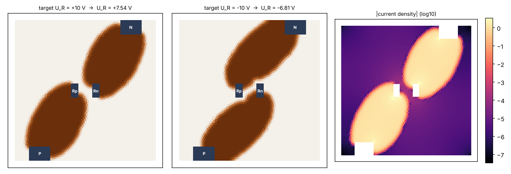
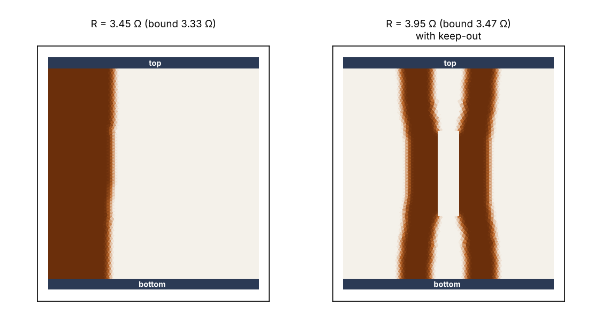
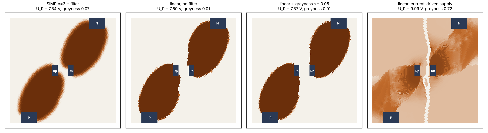
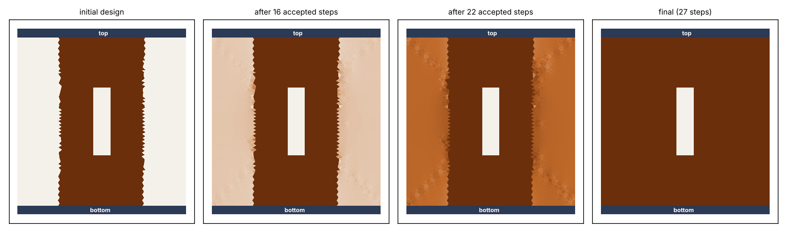
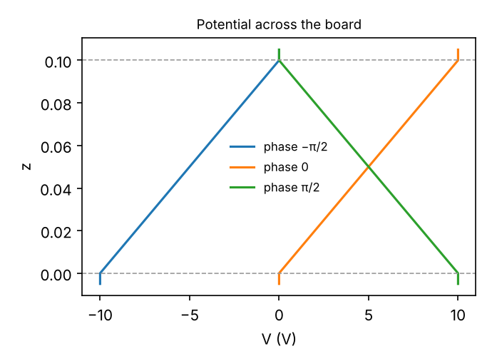
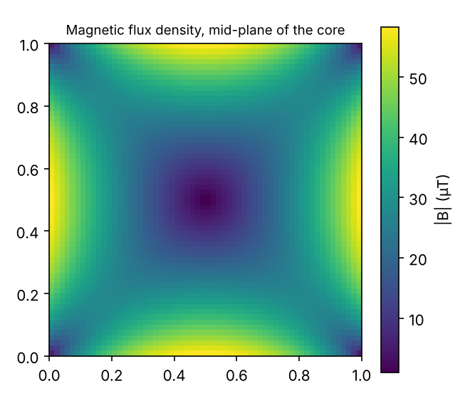

# Topology optimization of copper layouts on printed circuit boards

*Minka Dubourg, September 2024 – June 2025*

Copper layouts on PCBs are usually drawn by hand, following design rules that are partly empirical. This project asks a different question: if the copper distribution is treated as an unknown field, can it be computed? The answer should come from the circuit's requirements, such as the voltage a component must see, the losses, or the copper budget, rather than from rules of thumb.

The approach is density-based topology optimization. Each finite element of the board carries a copper density ρ ∈ [0, 1]. The electrical problem is solved with NGSolve, gradients are computed with the adjoint method, and the densities are updated by steepest descent or by the Method of Moving Asymptotes (MMA). Components enter the model as equipotential pads coupled by lumped laws, so a layout is optimized together with the circuit it serves.

<p align="center"></p>

## Main results

1. **The adjoint gradient is exact at a 10⁶ copper/void conductivity contrast.** Centred finite differences agree with it to better than 10⁻⁴ relative. This holds for three objectives (voltage across a component, Joule losses, field energy), for both the linear and the penalised conductivity law, and through the density filter. The model is a standard steady-conduction model, so no compromise contrast is needed.
   - An earlier version of this work could only make MMA converge with a contrast of 10² in the physics and 10⁶ in the gradient.
   - The cause was the derivative passed to MMA, which was not the adjoint gradient. Also, the voltage target differed between the objective and its derivative.
   - With the adjoint gradient, the physical contrast works directly. Lowering the contrast to 10² actually makes the design worse (row "σ_min = 0.01" below), because the board itself starts to shunt the resistor.

2. **Results match the analytic optimum on a validation case.** Consider a plate between two full-width electrodes with a 30 % copper budget. The minimum resistance is that of straight bars of total width 0.6: R\* = 2/0.6 = 3.33 Ω. MMA finds layouts whose thresholded (pure copper / no copper) resistance is 3.338 Ω (+0.1 %). With a keep-out zone in the middle, it finds 3.508 Ω against a bound of 3.472 Ω (+1.0 %): the copper splits around the obstacle.

<p align="center"></p>

3. **A current-driven supply makes the routing problem degenerate; a voltage-driven one does not.** The resistor test case aims for a given voltage U_R across a 10 Ω resistor.
   - With an ideal current source, U_R = I·R as soon as the current reaches the resistor, whatever the traces look like. The target is then met by a grey, non-physical design: greyness 0.72, U_R = 9.99 V. Once that design is thresholded to copper / no copper, it gives only 8.62 V.
   - With a 10 V supply, U_R = 10·R/(R + R_traces). The trace resistance now matters, and the optimizer builds two wide, short traces, P → Rp and Rn → N.
   - When the polarity is reversed (target −10 V), the layout reroutes: P → Rn and Rp → N, without crossing. It reaches a smaller |U_R| (6.81 V versus 7.54 V) because the paths are longer.

4. **No grey-material constraint is needed here.** With the linear conductivity law and no filter, MMA already converges to an almost binary layout (greyness 0.014, U_R = 7.60 V). The earlier formulation limited intermediate material with ∫ρ(1−ρ) ≤ 0.4. Since ρ(1−ρ) ≤ 1/4, that bound can never be active. A bound of 0.05 changes nothing either (U_R = 7.57 V).
   - The penalised law (SIMP, p = 3) with a density filter gives smoother boundaries and a minimum feature size, at the same performance (7.64 V after thresholding).

| run (target +10 V unless stated) | U_R (V) | U_R thresholded (V) | greyness |
|---|--:|--:|--:|
| SIMP p = 3 + filter | 7.54 | 7.64 | 0.067 |
| SIMP p = 3 + filter, target −10 V | −6.81 | −6.96 | 0.067 |
| linear, no filter | 7.60 | 7.59 | 0.014 |
| linear + greyness ≤ 0.05 | 7.57 | 7.56 | 0.013 |
| linear, **current-driven** supply | 9.99 | 8.62 | 0.717 |
| SIMP p = 3, σ_min = 10⁻² | 6.84 | 7.00 | 0.065 |
| SIMP p = 3, σ_min = 10⁻⁴ | 7.53 | 7.63 | 0.067 |
| SIMP p = 3, σ_min = 10⁻⁶ | 7.54 | 7.64 | 0.067 |

Greyness is the area-average of 4ρ(1−ρ): 0 for a pure copper / no copper layout, 1 for uniform grey. "Thresholded" means the same physics re-solved after setting ρ = 1 where ρ > 0.5 and 0 elsewhere, which is the layout one would actually etch. All runs use 30 % copper, 200 MMA iterations and a mesh of about 10 000 elements, and each takes 20–75 s.

<p align="center"></p>

5. **Without a copper budget, copper fills the board.** Steepest descent on the field energy ½∫|∇u|², starting from a central bar, fills every allowed element in 27 accepted steps and leaves the keep-out zone empty. This is the correct answer, since more copper always lowers the field. It shows why a constraint, and therefore MMA, is needed.

<p align="center"></p>

## Model

**Conduction with pads and components (2D, one copper layer).**
- The potential satisfies ∇·(σ(ρ)∇u) = 0, with σ(ρ) = σ_min + (σ_max − σ_min)ρ^p.
- Each pad (a connector or a component lead) is an equipotential with an unknown voltage U_p. The potential is written u = u₀ + Σ U_p φ_p, where φ_p equals 1 on the pad.
- Components add their current–voltage laws to the current balance at the pads (Kirchhoff's law). For resistors this keeps the system symmetric, so the adjoint reuses the LU factorisation of the direct solve.
- Pads are driven either by injected currents or by imposed voltages.

**Adjoint.** For K(ρ)x = f and an objective J(x), solve Kλ = −∂J/∂x. Then

dJ/dρ_e = σ'(ρ_e) ∫_e ∇u·∇λ dx.

**Time-harmonic A–V model (3D).**
- Two copper planes surround a core. The planes are driven with complex voltages, so they can be out of phase.
- The scalar potential follows from conservation of the total current, ∇·((σ + jωε)∇V) = 0.
- The vector potential follows from ∇×(ν∇×A) + (jωσ − ω²ε)A = −(σ + jωε)∇V. Neglecting the feedback of A on V (quasi-static regime) turns the coupled system into two symmetric solves that take seconds.
- Checks: the planes come out equipotential, V is linear across the core to 5·10⁻⁸, and Ampère's law ∮B·dl = μ₀I holds to 2·10⁻⁴ on loops in the core.

<p align="center"> </p>

The derivations (weak forms, adjoint, filter, A–V formulation) are in [`docs/method.md`](docs/method.md).

## Usage

```bash
pip install -e ".[dev]"       # NGSolve, scipy, mmapy
pytest                        # 20 tests, ~5 s

python examples/electrode_plate.py    # validation cases          -> figures/plate_*.png
python examples/resistor_board.py     # resistor routing study    -> figures/resistor_*.png
python examples/harmonic_board.py     # 3D time-harmonic model    -> figures/harmonic_*.png
```

```python
import numpy as np
from pcbtopo import ConductionModel, Port, Resistor, SIMP
from pcbtopo.geometry import resistor_board
from pcbtopo.objectives import PortVoltageTarget, VolumeFraction
from pcbtopo.optimize import Problem, mma

mesh = resistor_board(maxh=0.03)
model = ConductionModel(mesh, [Port("P", voltage=10), Port("N", voltage=0), Port("Rp"), Port("Rn")],
                        [Resistor("Rp", "Rn", 10.0)], interpolation=SIMP(p=3))
areas = model.element_area[model.design_mask]
problem = Problem(model, PortVoltageTarget(model, "Rp", "Rn", 10.0),
                  [VolumeFraction(areas, 0.3)], filter_radius=0.06)
rho, history = mma(problem, 0.3 * np.ones(model.n_design))
```

The tests cover the following:
- **Analytic resistances:** a full plate, and a single bar.
- **Power balance:** the power injected equals the Joule losses plus the resistor's dissipation.
- **Adjoint gradient:** checked against finite differences for every objective and both interpolation laws, with and without the filter.
- **MMA on Svanberg's toy problem:** the known solution is recovered.
- **MMA on the plate:** the resistance bound is recovered.
- **Harmonic model:** linear potential, linearity in the drive, and Ampère's law.

## Repository layout

```
pcbtopo/
  geometry.py       electrode plate (with keep-out), resistor board, two-plane 3D board
  conduction.py     conduction model with pads and lumped resistors, direct and adjoint solves
  interpolation.py  SIMP law, density filter
  objectives.py     voltage target, compliance, field energy, copper-area and greyness constraints
  optimize.py       projected steepest descent, MMA driver
  harmonic.py       time-harmonic A–V model (3D)
  plotting.py
examples/  tests/  figures/  results/  docs/method.md
```

## Limitations and next steps

- **One copper layer.** Real boards route on two or more layers connected by vias. The pad formulation already supports this: a via is a pad shared by two layer meshes. This is the next step.
- **Linear components only.** Nonlinear lumped laws need the component current as an extra unknown, which makes the system non-symmetric.
- **Objectives are electrical only.** Clearance rules, minimum trace width (the filter radius sets it only approximately) and thermal limits are not modelled.
- **The 3D time-harmonic model is not yet coupled to the optimization.** The adjoint of the A–V system is the natural extension.

## Credits

Thibault Moutet worked with me on the 2025 phase and wrote the class-based 3D geometry and solver code of that phase. That code is not included here. Thomas Gauthey (GeePs) provided guidance throughout. The pad and lumped-component formulation follows the approach of his circuit solver, and the implementation in this repository is new. MMA is used through [`mmapy`](https://github.com/arjendeetman/GCMMA-MMA-Python), Arjen Deetman's Python port of Svanberg's code, which is licensed under GPL-3.

## References

1. K. Svanberg, "The method of moving asymptotes — a new method for structural optimization," *Int. J. Numer. Methods Eng.* 24, 359–373, 1987.
2. M. P. Bendsøe, O. Sigmund, *Topology Optimization: Theory, Methods and Applications*, Springer, 2003.
3. T. E. Bruns, D. A. Tortorelli, "Topology optimization of non-linear elastic structures and compliant mechanisms," *Comput. Methods Appl. Mech. Eng.* 190, 3443–3459, 2001 (density filter).
4. J. Céa, "Conception optimale ou identification de formes, calcul rapide de la dérivée directionnelle de la fonction coût," *RAIRO M2AN* 20(3), 371–402, 1986 (adjoint method).
5. J. Schöberl, "NETGEN — An advancing front 2D/3D-mesh generator based on abstract rules," *Comput. Visual. Sci.* 1, 41–52, 1997; NGSolve, https://ngsolve.org.
6. A. Deetman, GCMMA-MMA-Python, doi:10.5281/zenodo.13197565.
